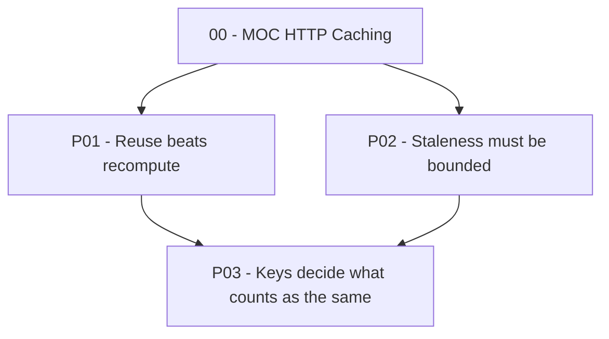

# Vault Structure

Obsidian-flavored Markdown. Wikilinks (`[[Note]]`) for notes inside the vault; normal `[text](url)` links for the web only.

## Folder layout

```
Learning/
└── <Topic>/
    ├── 00 - MOC <Topic>.md          map of content + decision tree (start here)
    ├── 01 - Sources.md
    ├── 02 - Spec.md
    ├── 03 - Glossary.md
    ├── _Progress.md                 learner profile, mastery, misconceptions, review dates
    ├── Parking Lot.md               tangents saved for later
    ├── Write-ups/                   optional public write-ups (/writeup)
    ├── Principles/
    │   ├── P01 - <claim, short>.md
    │   └── P02 - ...
    ├── Tickets/
    │   ├── T01.1 - <title>.md
    │   └── ...
    ├── Math/
    │   └── <Equation name>.md
    └── Drills/
        ├── Faults.md
        ├── Transfer.md
        └── Flashcards.md
```

File names: no `/ \ : * ? " < > |` characters. Keep them under about 60 characters.

## Callout conventions (all built-in types, no CSS needed)

| Use | Callout |
|---|---|
| Principle statement | `> [!abstract] Principle` |
| Pivotal component ★ | `> [!tip] Pivotal ★` |
| Mapped analogy | `> [!example] Analogy` (must contain the mapping table and "where it breaks") |
| Question for the learner | `> [!question]` |
| Fault drill | `> [!bug] Fault` |
| Unverified claim | `> [!warning] Unverified` |
| Depth limit | `> [!info] Depth limit` |
| Learner's own answer (translation test) | `> [!quote] My explanation` |

## Decision tree in the MOC

Obsidian renders Mermaid natively. Give each node the *exact* note name as its label and add the `internal-link` class so nodes become clickable:

````markdown

````

Mark pivotal principles with ★ in the spec table, not in node labels, or the link will not match the note name.

## Templates

### `00 - MOC <Topic>.md`

```markdown
---
type: moc
topic: <Topic>
mode: build | understand
created: YYYY-MM-DD
tags: [learning/<topic>, moc]
---
# <Topic>

**One-sentence purpose:** ...
**Learner goal:** ...

## Decision tree
<mermaid, as above>

## Principles (in teaching order)
1. [[P01 - ...]] ★
2. [[P02 - ...]]

## Other notes
[[01 - Sources]] · [[02 - Spec]] · [[03 - Glossary]] · [[_Progress]] · [[Parking Lot]]
```

### `02 - Spec.md`

```markdown
---
type: spec
topic: <Topic>
tags: [learning/<topic>, spec]
---
# Spec: <Topic>

## Purpose
What problem it solves, and what breaks without it.

## Fundamental truths (cannot be otherwise)
- ... [T1]

## Design choices (could be otherwise)
| Choice | Alternative | Trade-off |
|---|---|---|

## Principles
| ID | Principle (as a claim) | ★ | Removal test result | Depends on | Real-world instance |
|---|---|---|---|---|---|

## Assumption ledger
| Principle | Assumption | If violated → symptom |
|---|---|---|

## Ticket stubs
- P01: [[T01.1 - ...]], [[T01.2 - ...]]

## Known faults and open questions

## Depth limits

## Decision tree
<mermaid>
```

### `Principles/P0N - <name>.md`

```markdown
---
type: principle
id: P0N
pivotal: true | false
status: not-started | in-progress | landed | shaky | practiced | mastered
handle: "<two-to-five-word name>"
depends_on: ["[[P01 - ...]]"]
tags: [learning/<topic>, principle]
---
# P0N - <name>

> [!abstract] Principle
> <The claim, one or two sentences.>

## Derivation
Premises that together lead to this claim: [[P0X - ...]], [[P0Y - ...]]

## Why it matters to the whole
## Explanation (example first, then rule)
## Analogy
> [!example] Analogy
> | Analogy piece | System piece | Variable / code / component |
> |---|---|---|
> **Where it breaks:** ...

## Math
![[<Equation name>]]

## In the code
`path/file.ext`, `function()`, lines N to M: what happens here and why.

## Assumptions and failure modes
## Transfer: where else this shows up
## My explanation
> [!quote] My explanation
> <Learner's passing translation test, in their words>

## Tickets
- [[T0N.1 - ...]]
```

### `03 - Glossary.md`

```markdown
| Term | Plain definition | First seen in |
|---|---|---|
```

### `_Progress.md`

```markdown
---
type: progress
topic: <Topic>
tags: [learning/<topic>, progress]
---
# Progress

## Learner profile
Goal, prior knowledge, diagnostic results, chosen depth.

## Probe report
| Strand | Floor | Ceiling | Misconceptions seen | Build from |
|---|---|---|---|---|

## Mastery
| Principle | Status | Translation test | Fault | Transfer | Last reviewed | Next review |
|---|---|---|---|---|---|---|

## Misconceptions log
| Date | Misconception | Source | Confidence when stated | Corrected? | Root cause | Recheck on |
|---|---|---|---|---|---|---|

Source is one of: `session`, `exam`, `check`, `listen`, `drill`, `practice`. Root cause holds an ID from the table below, once one is confirmed.

## Exam log
| Date | Scope | Start level | Ceiling | What broke | Next step |
|---|---|---|---|---|---|

## Root causes
| ID | Belief (one sentence) | Status (hypothesis / confirmed / fixed) | Evidence | Fix plan | Recheck on |
|---|---|---|---|---|---|

## Practice log
| Date | Target | Mode | Cue setting | Highest hint rung | Miss class | Retest result |
|---|---|---|---|---|---|---|

## Gaps (skipped or told, not derived)

## Session log
- YYYY-MM-DD: covered ..., next ...
```

Principle and spec notes hold true claims about the subject only. Everything about the learner lives here.

**Review schedule:** after an item first reaches `practiced`, review at 1, 3, 7, 14, and 30 days. A failed review resets the item to the 1-day interval. Use the session dates the learner gives you; you do not have a clock between sessions.

### `Drills/Flashcards.md`

Compatible with the community **Spaced Repetition** plugin. The cards still read fine without it.

```markdown
---
tags: [flashcards/<topic>]
---
#flashcards/<topic>

What does λ control in N(t) = N₀e^(−λt)?::How fast the amount shrinks; larger λ means faster decay.

Why does doubling a taxi trip not double the fare?
?
Because the flag-drop fee b is charged once and does not scale with distance x.
```

Write cards that test reasoning ("why", "what happens if"), not only definitions.

### `Drills/Faults.md` and `Drills/Transfer.md`

One section per principle. Keep the prompt, the learner's answer, and the verdict, so the drill can be retried later.
